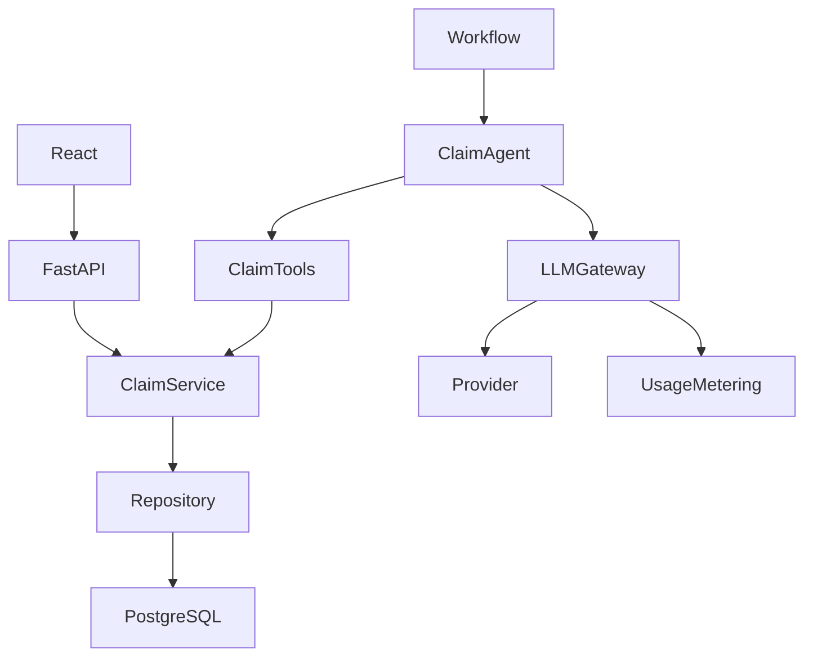

# Architecture

Each module is a complete independently runnable copy of the reference architecture, with one small learner boundary. React displays persisted records; FastAPI delegates state changes to ClaimService.

The agent retrieves facts through ClaimTools and calls LLMGateway for inference. The gateway validates shape and references before ClaimService records the summary or advice and creates manager review. An ARQ worker consumes a separate module queue. Failed model processing leaves the claim undecided and records an execution failure.

## Actual codebase map

Within either module's `backend/app/`:

| Path | Owns |
| --- | --- |
| `api/routes.py` | HTTP boundary |
| `assessment/service.py` | Business state, source facts, manager actions |
| `domain/policy.py` | Deterministic policy findings |
| `agents/claim_agent.py` | Bounded AI orchestration |
| `tools/claims.py` | Agent-accessible application capabilities |
| `exercises/` | One learner-owned boundary |
| `ai/gateway.py`, `ai/providers/` | Provider-neutral inference and adapters |
| `schemas/assessment.py` | Strict factual / recommendation contract |
| `db/models/`, `db/repositories/`, `db/session.py` | Persistence |
| `workflows/process_claim.py` | End-to-end processing and safe failure |
| `jobs/worker.py` | Background execution |
| `rag/` | Optional policy retrieval and index |
| `evaluation/` | Reference behavior evaluation |
| `analytics/` | AI execution usage, cost and latency |
| `assistant/` | Grounded read-only chat |

## Boundaries

- Agent ≠ database access: tools delegate to ClaimService.
- LLM ≠ policy engine: application code calculates checks first.
- Recommendation ≠ final decision: the manager records Accept/Reject.
- AI output ≠ trusted until validated: strict schema plus known finding/evidence IDs.
- Evidence ≠ model-generated text: source evidence comes from persisted records.

The existing API uses `findings` for finding codes and lowercase `accept`/`reject` for recommendations. The UI displays Accept/Reject. Preserve this reference contract; do not rename model fields to match prose.

## Isolation

| Resource | Module 1 | Module 2 |
| --- | --- | --- |
| Database | `exercises_module1` | `exercises_module2` |
| Queue | `exercises-module1` | `exercises-module2` |
| PostgreSQL / Redis ports | 55432 / 56379 | 55432 / 56379 |
| API / frontend ports | 8000 / 5173 | 8000 / 5173 |

Stop one application before starting the other. Bootstrap/reset refuse unexpected database names or infrastructure addresses. Reset operates only on the selected module's dedicated data. No script uses the demo Compose project.

Usage telemetry shows how the AI runtime is operating. It does not tell us by itself whether the AI response is correct.
